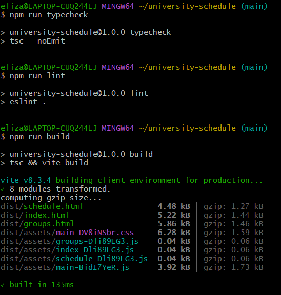

\# Лабораторна робота №6

\## Міграція клієнтського коду на TypeScript та Vite


\###Мета роботи


Перенести клієнтський код проєкту на TypeScript, налаштувати збірку за допомогою Vite, додати статичні перевірки коду та форматування.


\###Посилання на проєкт


\- Репозиторій GitHub: https://github.com/024864-netizen/university-schedule

\- Опублікований сайт: https://024864-netizen.github.io/university-schedule/


\###Виконання роботи


1\. Налаштовано проєкт на базі Vite.

2\. Перенесено клієнтський код із JavaScript до `src/main.ts`.

3\. Створено окремий файл `src/types/index.ts` з доменними типами.

4\. Налаштовано строгий режим TypeScript у `tsconfig.json`.

5\. Додано ESLint для статичного аналізу коду.

6\. Додано Prettier для автоматичного форматування.

7\. Налаштовано перевірку зовнішніх даних, отриманих через `fetch`.

8\. Налаштовано production-збірку трьох HTML-сторінок: головної, розкладу та груп.

9\. Перевірено локальну production-збірку в браузері.


\###Налаштування TypeScript


У файлі `tsconfig.json` увімкнено строгий режим та додаткові перевірки:


```json

{

&#x20; "strict": true,

&#x20; "noUncheckedIndexedAccess": true,

&#x20; "exactOptionalPropertyTypes": true,

&#x20; "noUnusedLocals": true,

&#x20; "noUnusedParameters": true,

&#x20; "noFallthroughCasesInSwitch": true,

&#x20; "noImplicitReturns": true,

&#x20; "noImplicitOverride": true,

&#x20; "noEmit": true

}

```


Параметр `strict` активує суворі перевірки типів. `noUncheckedIndexedAccess` допомагає виявляти можливі невизначені значення під час доступу за індексом. `noUnusedLocals` і `noUnusedParameters` виявляють невикористані змінні та параметри. `noEmit` забороняє TypeScript генерувати окремі JavaScript-файли, оскільки трансформацію виконує Vite.


\###Створені типи


У файлі `src/types/index.ts` визначено:


\- `RecordItem` — тип елемента даних із полями `id`, `title`, `text` і `category`.

\- `Theme` — об’єднання допустимих значень теми: `light` та `dark`.

\- `LoadingState` — об’єднання типів стану завантаження: `loading`, `success`, `empty` та `error`.


\###Перевірка зовнішніх даних


Результат `response.json()` розглядається як `unknown`. Перед використанням даних функції `isRecord` та `isRecordArray` перевіряють структуру об’єктів і допустимі значення категорій. У разі помилки завантаження користувач бачить повідомлення та кнопку повторної спроби.


\###Команди проєкту


\- `npm run dev` -запуск сервера розробки.

\- `npm run typecheck` -перевірка типів TypeScript.

\- `npm run lint` -статичний аналіз коду.

\- `npm run format`- форматування файлів.

\- `npm run build`- перевірка TypeScript і production-збірка.

\- `npm run preview`-локальний перегляд production-збірки.


\###Результати перевірок


Команди `npm run typecheck`, `npm run lint` та `npm run build` виконано успішно. Production-збірка містить три HTML-сторінки. Локально перевірено роботу сторінок, завантаження даних та інтерактивних елементів.


\### Висновок


Під час лабораторної роботи клієнтський код проєкту перенесено на TypeScript, налаштовано Vite, строгі перевірки типів, ESLint і Prettier. Реалізовано перевірку зовнішніх даних і перевірено production-збірку в локальному браузері.
### Скріншот успішних перевірок


